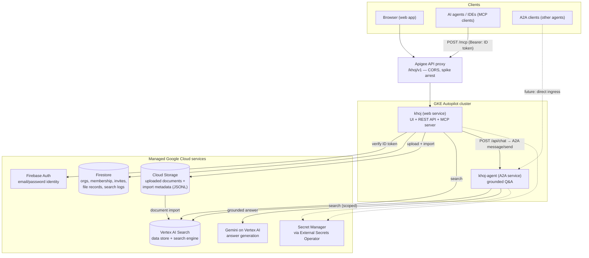

# Khoj.ai — Software Design Review (SDR)

| | |
|---|---|
| **Document** | Khoj.ai — Hosted Document Search Platform: System Design |
| **Version** | 0.1 (Draft for review) |
| **Date** | November 2, 2026 |
| **Author** | Anuj Gupta |
| **Status** | Implemented as a working proof of concept; presented for design review |

---

## 1. Overview

Khoj.ai is a hosted, multi-tenant document-search platform. Users upload
documents; the platform indexes them into a managed search engine and offers
three consumption surfaces over the same corpus:

1. **Web application** — search, document management, and a conversational
   chat interface grounded in the user's documents.
2. **MCP server** — the corpus is exposed as tools to any MCP-capable agent
   (agent frameworks, IDEs, desktop assistants).
3. **A2A agent** — a standards-based agent endpoint (AgentCard + JSON-RPC)
   that answers questions over the corpus, consumable by other agents —
   including skill-based agent platforms such as Laya.

The platform supports two tenancy flavors with one codebase:

- **Individuals** sign up directly and search a private, per-user corpus.
- **Businesses (organizations)** enroll once; an org admin uploads to a
  shared business corpus, invites employees, and applies org branding.

A **platform operator** role (super admin) approves business signups and
monitors platform-wide usage and retrieval quality.

### 1.1 Problem statement

Teams evaluating RAG stacks repeatedly rebuild the same undifferentiated
plumbing: document ingestion, index management, per-user isolation, auth,
and an answer layer. Self-hosted OSS options (e.g., OpenRAG) provide the
retrieval core but no signup, no multi-tenancy, and no managed control
plane. Khoj.ai packages those concerns as a hosted platform on managed
Google Cloud services, so a POC or internal tool can be stood up without
operating a search cluster.

### 1.2 Goals

- Managed, serverless-leaning infrastructure (no VMs to operate).
- Strict corpus isolation between users and between organizations.
- Standards-based agent interoperability: **MCP** for tools, **A2A** for
  agent-to-agent question answering.
- One-command, reproducible deployment: container images + Helm charts +
  CI pipeline.
- Credentials never in source control or chart values — external secrets
  management only.
- Full operator visibility: every search, upload, and chat is logged for
  quality metrics (zero-result rate, latency, corpus activity).

### 1.3 Non-goals

- Replacing the retrieval engine itself (the platform builds on Vertex AI
  Search rather than operating its own vector store).
- Email delivery for invitations in v1 (invite links are shared out of
  band; see §11).
- Custom domains / TLS termination per tenant in v1.

---

## 2. System architecture



### 2.1 Components

| Component | Technology | Responsibility |
|---|---|---|
| Web service (`khoj`) | FastAPI (Python), single-page UI | Auth verification, REST API, corpus-scoped search, uploads/import, org management, super-admin APIs, MCP server, A2A client for chat |
| Agent service (`khoj-agent`) | FastAPI, A2A protocol 0.3.0 | AgentCard discovery, `message/send` + `message/stream`; retrieves scoped chunks and generates a grounded, cited answer with Gemini |
| Identity | Firebase Authentication | Email/password accounts; ID tokens (JWT) are the single credential across web, MCP, and A2A |
| Tenancy + state | Firestore (Native) | Organizations, memberships, invites, per-file status records, append-only search/conversation logs |
| Document storage | Cloud Storage | Raw uploads under per-scope prefixes; per-file JSONL metadata for import |
| Retrieval | Vertex AI Search (Standard edition) | Managed indexing + hybrid search over all corpora in one data store, separated by metadata (see §4) |
| Answer generation | Gemini (Vertex AI) | Grounded answer synthesis in the agent service; extractive fallback when unavailable (§7.3) |
| Edge | Apigee (evaluation org) | API proxy: CORS policy, spike arrest (100/min); authentication remains in-service |
| Delivery | Cloud Build + Helm | Build images → Artifact Registry → `helm upgrade` per service |
| Secrets | External Secrets Operator ← Google Secret Manager | The only credential path into the cluster; services otherwise use Workload Identity |

### 2.2 Why these choices

- **Vertex AI Search over a self-run vector store:** the POC's purpose is
  evaluating retrieval *products*, not operating clusters. The managed
  engine removes OpenSearch operations from the platform at a predictable
  per-query price (§9).
- **One data store for all corpora:** a single store with metadata-scoped
  documents keeps operations (and cost) flat as tenants grow; isolation is
  enforced in the service layer (§4) rather than by store proliferation.
- **Firebase Auth:** zero-ops identity with JWT verification libraries for
  every consumer surface; the same token works for the web UI, MCP tools,
  and the A2A agent.
- **A2A + MCP both:** MCP serves tool-style consumption (an agent calling
  search as a function); A2A serves agent-style consumption (delegating a
  question to a specialist agent). They are complementary, not redundant.

---

## 3. Core flows

### 3.1 Upload and indexing

```mermaid
sequenceDiagram
    participant U as User
    participant W as Web service
    participant G as Cloud Storage
    participant V as Vertex AI Search
    participant F as Firestore

    U->>W: POST /api/upload (file, ID token, optional orgId)
    W->>W: Verify token; check upload role (owner / org admin)
    W->>G: Store file at {scope}/{filename}
    W->>G: Write metadata JSONL (id, structData, content URI)
    W->>V: Import documents (dataSchema: document, INCREMENTAL)
    W->>F: Record file status (indexing, import operation id)
    W-->>U: {documentId, status: indexing}
    Note over U,V: UI polls document list; status flips to<br/>ready / failed when the import settles
```

Design details:

- **Deterministic document IDs:** `doc-` + first 24 hex chars of
  `sha256(scope + "/" + filename)` — re-uploading the same file to the same
  corpus is idempotent.
- **Import mode matters:** documents are imported with
  `dataSchema: "document"` and records of the shape
  `{id, structData, content}`. (The `"custom"` mode parses each line as raw
  schema data and rejects this record shape — a integration defect found
  and fixed during the POC.)
- **File status is a first-class feature:** uploads appear in the document
  list immediately with `indexing` / `ready` / `failed` status (failed
  carries the import error), merged from Firestore records and the live
  index; the UI auto-refreshes while anything is indexing.

### 3.2 Search

```mermaid
sequenceDiagram
    participant C as Client (web / MCP / agent)
    participant W as Web service
    participant V as Vertex AI Search

    C->>W: Query + ID token (+ optional orgId)
    W->>W: Verify token; resolve scope (personal uid or org membership)
    W->>V: Search (Standard spec: snippets)
    V-->>W: Hits with structData
    W->>W: Post-filter: drop hits outside the caller's scope
    W-->>C: Scoped results (title, link, cleaned snippets)
    W->>W: Log event (query, result count, latency) → Firestore
```

### 3.3 Chat (A2A)

```mermaid
sequenceDiagram
    participant U as User (chat widget)
    participant W as Web service
    participant A as khoj-agent (A2A)
    participant V as Vertex AI Search
    participant G as Gemini

    U->>W: POST /api/chat {message, contextId?, orgId?}
    W->>A: JSON-RPC message/send (caller's ID token forwarded)
    A->>A: Verify token; resolve scope
    A->>V: Scoped search for the question
    V-->>A: Chunks (post-filtered to scope)
    A->>G: Answer using ONLY these excerpts, cite [n]
    G-->>A: Grounded answer
    A-->>W: {reply, contextId, sources}
    W-->>U: Reply rendered in the side-panel chat widget
```

The web UI presents chat as a floating action button opening a pinned
right-side panel — the conventional support-widget pattern — rather than an
in-page form.

---

## 4. Multi-tenancy and isolation

| Layer | Mechanism |
|---|---|
| Identity | Firebase ID token on every request; the verified `uid` is the only identity input — clients cannot assert identity |
| Document metadata | Every imported document carries `structData.user_id` (personal corpus) or `structData.org_id` (business corpus) |
| Authorization | Personal scope: `uid` match. Business scope: Firestore membership lookup for `(orgId, uid)`; org must be `approved` (platform org members bypass for inspection) |
| Enforcement | The data store's auto-derived schema exposes no filterable fields, so server-side Vertex filters are rejected by the API. Isolation is therefore enforced by **post-filtering**: the service queries, then drops every hit whose `structData` does not match the verified scope. Authorization gates (membership, org status) run before any data is returned |
| Roles | Org **admin** (enroller; uploads, invites, branding, member management) and **member** (search/chat). The last admin of an org cannot be removed |
| Platform tenancy | The platform itself is an org (`khoj`); its admins are **super admins** across all tenants |

Residual-risk note: post-filtering means the engine internally scores
out-of-scope documents before they are dropped. Result counts are computed
after filtering, and no out-of-scope content leaves the service; a future
hardening step is a filterable-schema data store (custom schema with
filterable `user_id`/`org_id`) to move enforcement into the engine (§11).

---

## 5. Data model

### 5.1 Firestore

| Collection | Key fields | Purpose |
|---|---|---|
| `orgs/{orgId}` | name, slug, createdBy, branding{displayName, logoUrl, primaryColor, tagline}, status (`pending`/`approved`/`rejected`) | Tenant registry |
| `orgs/{orgId}/members/{uid}` | email, role (`admin`/`member`) | Membership + RBAC |
| `orgs/{orgId}/invites/{inviteId}` | email, role, invitedBy, status, secretHash (SHA-256 of the one-time secret) | Invitations; the raw secret exists only in the shared link |
| `file_uploads/{docId}` | scopeKey (`user:<uid>` / `org:<orgId>`), filename, import operation, uploadedAt | File status (§3.1) |
| `search_logs/{eventId}` | uid, email, kind (`search`/`chat`/`upload`/`mcp`), query, summary, resultCount, latencyMs, source, at | Operator visibility + RAG quality metrics (§8) |

### 5.2 Cloud Storage layout

```
gs://<bucket>/
  users/{uid}/{filename}            personal corpus objects
  orgs/{orgId}/{filename}           business corpus objects
  meta/{scope}/{filename}.jsonl     import metadata (one record per file)
```

### 5.3 Search index document

```json
{
  "id": "doc-<24 hex>",
  "structData": { "user_id": "<uid>", "owner_email": "...", "title": "..." },
  "content": { "mimeType": "text/html", "uri": "gs://<bucket>/users/<uid>/<file>" }
}
```

---

## 6. APIs

### 6.1 REST (web service; all require `Authorization: Bearer <Firebase ID token>`)

| Endpoint | Purpose |
|---|---|
| `GET /api/me` | Caller profile: email, admin / superAdmin flags |
| `POST /api/search` | Corpus-scoped search (`query`, optional `orgId`) |
| `POST /api/chat` | Chat via the A2A agent (`message`, `contextId`, `orgId`) |
| `POST /api/upload` | Upload + import a document (multipart; optional `orgId`) |
| `GET /api/documents` | Caller's documents with status (`ready`/`indexing`/`failed`) |
| `POST /api/orgs`, `GET /api/orgs` | Create (starts `pending`) / list the caller's organizations |
| `GET/POST /api/orgs/{id}/members` | List / add members (admin) |
| `POST /api/orgs/{id}/invites` | Create a one-time invite link (admin) |
| `GET /api/invites` | Caller's pending invitations (email match) |
| `GET /api/public/org/{slug}` | Public branding for the branded sign-in page (`/?org=<slug>`) |
| `GET /api/admin/metrics`, org approval endpoints | Super admin: platform metrics, approve/reject org signups, recent conversations |

### 6.2 MCP server (`POST /mcp`, Streamable HTTP, protocol 2025-03-26)

Same Bearer ID-token authentication. Tools:

| Tool | Description |
|---|---|
| `search_documents` | Search the caller's corpus (optional `orgId` for a business corpus) |
| `list_my_documents` | List the caller's indexed documents |
| `list_my_corpora` | List corpora available to the caller (personal + org memberships) |

Known limitation: Firebase ID tokens expire in ~1 hour, so MCP clients must
refresh tokens; long-lived personal API keys are the planned v2 credential
(§11).

### 6.3 A2A agent (`khoj-agent`)

- Discovery: `GET /.well-known/agent-card.json` — name "Khoj Document
  Assistant", protocol 0.3.0, streaming capability, `firebaseBearer`
  security scheme, skill `answer-questions`.
- Methods: `message/send`, `message/stream` (SSE) on `POST /` and `/a2a`.
- Errors follow A2A/JSON-RPC conventions (auth `-32001`, forbidden
  `-32003`, invalid params `-32602`).
- Conversation state: per-`contextId` history held in memory (last 6
  turns; 4 supplied to the model) — deliberately stateless infrastructure,
  state is reconstructible from `search_logs`.
- The agent is cluster-internal in v1; the web service is its A2A client.
  External exposure (own ingress + TLS) is a listed next step (§11).

---

## 7. Answer generation

### 7.1 Grounding contract

The agent answers **only** from retrieved excerpts: the prompt instructs
the model to answer from the supplied chunks, cite them inline (`[1]`,
`[2]`), and state plainly when the corpus does not contain the answer. If
search returns nothing, the agent replies that it could not find relevant
material rather than improvising.

### 7.2 Snippet hygiene

Vertex snippet markup (highlight tags such as `<b>`, HTML entities such as
`&nbsp;`) is stripped in both the web and agent services before display and
before being placed into the model prompt, so answers render as clean
prose.

### 7.3 Extractive fallback

If the model call is unavailable for any reason, the agent falls back to an
extractive answer (the top excerpts, labeled as fallback mode) — chat never
hard-fails. **Current POC status:** in the present project, Gemini model
access is not yet enabled at the platform level (all publisher-model calls
return not-found for this project, for both user and service-account
identities, while the search services operate normally), so chat currently
runs in extractive mode. This is an environment enablement item, not an
application defect; the fallback exists precisely so the system remains
demonstrable in the meantime.

---

## 8. Operator plane (super admin)

- **Org lifecycle:** business signups start `pending`; a super admin
  approves or rejects them. Pending orgs can brand and invite, but their
  corpus stays closed.
- **Visibility:** every search, chat, upload, and MCP call is logged
  (`search_logs`). The admin panel shows recent conversations across
  tenants and aggregate RAG metrics: total events, last-7-day volume,
  average latency, zero-result rate, unique users, web-vs-MCP split, top
  corpora, org counts by status.
- **Bootstrap:** platform-org membership is granted by an operator script
  (`scripts/set_super_admin.py <email>`, idempotent); there is no
  self-service path to super admin.

---

## 9. Deployment and delivery

| Concern | Design |
|---|---|
| Compute | GKE Autopilot cluster; one Helm chart per service (`khoj`, `khoj-agent`); each chart = Deployment + ClusterIP Service (+ Ingress for the web service) |
| Identity of workloads | Workload Identity: Kubernetes service accounts bound to one app Google service account (`discoveryengine.viewer/editor`, `datastore.user`, `firebaseauth.viewer`, `aiplatform.user`, bucket-scoped `storage.objectAdmin`) |
| Images | Cloud Build pipeline (`cloudbuild.yaml`): build → push to Artifact Registry (in-step, tagged `SHORT_SHA` + `latest`) → `helm upgrade` per service. The deploy step authenticates to the cluster with a static bearer-token kubeconfig (the helm builder image lacks the GKE auth plugin) |
| Edge | Apigee proxy `khoj-api`, base path `/khoj/v1`, CORS + spike arrest; target = the web ingress |
| Secrets | No credentials in values or git. External Secrets Operator syncs from Google Secret Manager (ClusterSecretStore via Workload Identity). Firebase *web* config in values is public identifier material, not a secret |
| Environments | Single POC environment today; charts are environment-agnostic (values-driven project, engine, datastore, branding) |

### Cost model (Vertex AI Search, Standard edition)

| Item | Rate |
|---|---|
| Queries | $1.50 / 1k (first 10k/month free) |
| Indexed data | $5 / GB-month (first 10 GB free) |
| Ingestion | No per-document fee |

Indicative: POC/demo usage ≈ $0; 50k queries/month ≈ $60; 100k ≈ $135
(Enterprise edition, which adds generative summaries, is ≈ $4/1k — an
upgrade decision, §11.) GKE Autopilot, Firestore, and Cloud Storage costs
at POC scale are within free/low tiers; the Apigee evaluation organization
is a trial (expires January 1, 2027).

---

## 10. Security design

- **Authentication:** Firebase ID tokens verified server-side on every
  endpoint, including MCP and A2A. No session cookies, no service-side
  passwords.
- **Authorization:** role checks per operation (upload = owner or org
  admin; member management = org admin; platform endpoints = super admin).
- **Tenant isolation:** metadata scoping + service-layer post-filtering
  (§4). Cross-tenant access was a specific test target in end-to-end
  verification (§12): a probe document owned by a test scope is invisible
  to every real user.
- **Secrets:** External Secrets Operator ← Secret Manager; workload
  identity for all Google API access; no long-lived keys in the cluster
  beyond what ESO syncs.
- **Invite security:** only the SHA-256 hash of the invite secret is
  stored; acceptance additionally requires the invitee's account email to
  match the invited email.
- **Edge controls:** Apigee spike arrest; auth remains in-service
  (defense in depth — the proxy is not the trust boundary).
- **Known gaps (v1):** ingress is HTTP on an IP address (no domain/TLS
  yet); the super admin can inspect all tenants' conversations by design
  (operator requirement) — this needs an audit/consent policy before any
  external-tenant use.

---

## 11. Limitations and roadmap

| # | Item | Direction |
|---|---|---|
| 1 | Chat in extractive mode until Gemini model access is enabled for the project (§7.3) | Platform enablement; no code change required |
| 2 | Isolation enforced by post-filtering (engine schema not filterable) | New data store with a custom, filterable schema to push enforcement into the engine |
| 3 | Standard edition: no generative summaries / extractive answers from the engine | Evaluate Enterprise edition ($4/1k) against summary quality needs |
| 4 | Invites are link-based; no email provider | Add a transactional email provider; key via Secret Manager |
| 5 | MCP/A2A auth uses 1-hour Firebase ID tokens | Personal API keys (hashed, revocable, per-user) as long-lived agent credentials |
| 6 | A2A agent is cluster-internal | Dedicated ingress + TLS + domain for external A2A clients |
| 7 | No domain / HTTPS on the web ingress | Attach domain, managed certificate |
| 8 | Apigee is an evaluation org (trial to Jan 1, 2027) | Decide on paid Apigee or fold its policies into the ingress |
| 9 | CI deploys are manually submitted | Cloud Build GitHub trigger (console OAuth connection) for push-to-deploy |
| 10 | Org deletion, branding logo upload (URL-only today), per-org quotas | Backlog, in that order |

---

## 12. Verification performed (POC, November 2, 2026)

End-to-end test with a fresh dummy account against the live deployment —
**8/8 flows passed:**

| Flow | Result |
|---|---|
| Signup + profile (`/api/me`) | Pass — correct non-admin flags |
| Upload a document | Pass — import accepted |
| File status | Pass — `ready` on first poll |
| Search | Pass — scoped hit, clean snippet (no markup leakage) |
| Chat | Pass — grounded answer from the uploaded document (extractive mode, per §7.3) |
| Create business | Pass — org created in `pending` state |
| Invite | Pass — one-time invite link issued |
| MCP | Pass — `initialize` + `tools/call search_documents` returned the document |

Additionally verified live: tenant isolation (out-of-scope probe document
invisible), super-admin bootstrap and panel, Apigee proxy routing to the
live ingress, and the full build → deploy → pod-rollout cycle across six
production deploys in one day.

---

## 13. Open questions for review

1. Is service-layer post-filtering acceptable for the next phase, or should
   the filterable-schema data store (item 2) be scheduled first?
2. Enterprise edition upgrade: is generative summarization worth ~2.7× the
   query price at expected volumes?
3. Should the platform target external tenants (requiring the §10 policy
   work) or remain an internal/POC tool?
4. Personal API keys for agents: acceptable credential model, or should
   MCP/A2A move to OAuth client credentials?

---

*End of document.*
